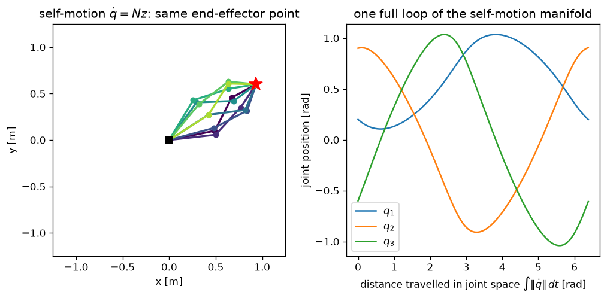
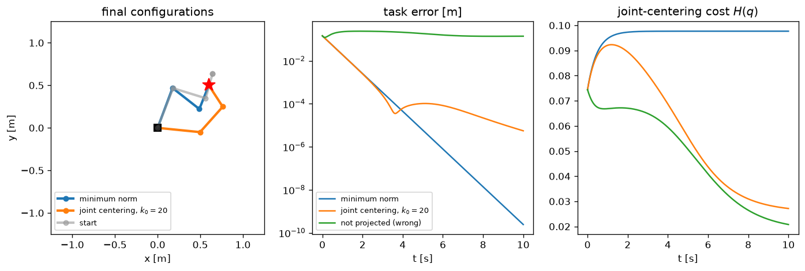

# 6 · Redundancy and null space

A manipulator is **kinematically redundant** for a task when it has more joints than the task has dimensions.
The extra freedom means that a task velocity is produced by infinitely many joint velocities; chapter 4 simply
took the one of smallest norm. This chapter describes the whole set of solutions, the **null space** that
separates them, and how to use it: to move the arm without moving the end-effector, to choose which joints do
the work, and to optimise a second criterion — joint centering, manipulability — while the task is still
executed exactly. Notation: [00_notation.md](00_notation.md); control law: [chapter 4](04_resolved_rate_control.md);
singular values: [chapter 5](05_singularities.md).

## 6.1 The set of solutions

Let $J \in \mathbb{R}^{m\times n}$ be the task Jacobian with $n > m$. The **degree of redundancy** is $r = n - m$:
a planar three-link arm controlling the position of its tip ($m = 2$) has $r = 1$; a seven-joint arm controlling
the full pose ($m = 6$) has $r = 1$; the six-joint PUMA controlling only position has $r = 3$. Redundancy is a
property of the arm *and* the task, not of the arm alone.

If $J$ has full row rank, every joint velocity that produces the task velocity $v$ is [1, 2, 6]

$$
\dot q = J^\dagger v + (I - J^\dagger J)\,z, \qquad z \in \mathbb{R}^n \text{ arbitrary}. \tag{6.1}
$$

The first term is the minimum-norm solution of chapter 4. It is a local choice: integrated along a closed task path
it does not in general bring the joints back to where they started (it is not *cyclic* [5]). The second term changes the joints without changing the
task, because $J(I - J^\dagger J) = J - JJ^\dagger J = 0$ (a defining property of the pseudoinverse).

## 6.2 The null space and its projector

The **null space** of $J$ is the set of joint velocities that do not move the task,

$$
\mathcal{N}(J) = \{\,\dot q : J\dot q = 0\,\}, \qquad \dim\mathcal{N}(J) = n - \operatorname{rank} J. \tag{6.2}
$$

Motion inside it is called **self-motion** or internal motion. The matrix

$$
N = I - J^\dagger J \tag{6.3}
$$

is the **orthogonal projector** onto $\mathcal{N}(J)$. It is symmetric ($N = N^T$) and idempotent ($N^2 = N$), it
annihilates the task ($JN = 0$), and its trace equals the dimension of the null space. With the SVD of chapter 5,
$J^\dagger J = \sum_{i:\,s_i>0} v_iv_i^T$, so $N$ keeps exactly the right singular vectors with zero singular value.
Any basis $Z$ of $\mathcal{N}(J)$ (columns spanning the null space) gives the same projector

$$
N = Z(Z^TZ)^{-1}Z^T, \tag{6.4}
$$

which is how the tests check (6.3): $Z$ is computed independently by LU decomposition, and the two projectors
agree to $10^{-10}$, also for rank-deficient $J$.

**Self-motion.** Integrating $\dot q = Nz$ moves the arm along the **self-motion manifold**, the set of
configurations with the same end-effector point. For the planar three-link arm ($l = 0.5, 0.4, 0.3$ m) it is a
closed curve: walking along it at unit speed in joint space, with $z$ set to the previous direction so the walk
does not stall, the arm returns to its start after $6.4$ rad of joint travel (Figure 6.1). With an explicit Euler
step of $2\times 10^{-3}$ rad the end-effector drifts by $1.1$ mm over the loop: $N$ is exact only at the
configuration where it was computed, and the error of each step is second order. In a controller this drift is
removed by the task feedback $K\tilde\sigma$.

*Figure 6.1 — Self-motion of a planar three-link arm: eight configurations with the same end-effector point (red
star), and the joint positions along one full loop of the self-motion manifold. Generated by
`tools/make_figures.py`.*

## 6.3 Weighted minimum norm

The pseudoinverse minimises $\lVert\dot q\rVert^2$, which treats all joints alike. Often they are not alike: a heavy
shoulder joint should move less than a light wrist joint, a mobile base less than the arm on it (chapter 9), and a
prismatic joint in metres cannot be compared with a revolute joint in radians at all. Give each joint a cost with a
symmetric positive definite weight $W$:

$$
\min_{\dot q}\ \tfrac12\,\dot q^TW\dot q \quad\text{s.t.}\quad J\dot q = v
\qquad\Longrightarrow\qquad
\begin{bmatrix} W & J^T \\ J & 0 \end{bmatrix}\begin{bmatrix}\dot q \\ \mu\end{bmatrix} =
\begin{bmatrix} 0 \\ v \end{bmatrix}. \tag{6.5}
$$

The first block row gives $\dot q = -W^{-1}J^T\mu$; substituting into the constraint gives $\mu$, and

$$
\dot q = J_W^\dagger v, \qquad J_W^\dagger = W^{-1}J^T\big(JW^{-1}J^T\big)^{-1}. \tag{6.6}
$$

For $W = I$ this is the pseudoinverse. A large $W_{ii}$ makes joint $i$ expensive, so it moves less. The
implementation (`weighted_pseudoinverse`) factorises $W = LL^T$, substitutes $\dot q = L^{-T}y$ so that
$\dot q^TW\dot q = \lVert y\rVert^2$, and returns $L^{-T}(JL^{-T})^\dagger$; this is (6.6) when $J$ has full row rank
and stays defined when it does not. The test solves the KKT system (6.5) directly and compares. The weighted
null-space projector is $I - J_W^\dagger J$; it is a projector ($N_W^2 = N_W$, $JN_W = 0$) but no longer symmetric.

## 6.4 Using the null space: gradient projection

Choose a scalar function $H(q)$ to be *minimised* without disturbing the task. Take $z = -k_0\nabla H$ in (6.1),
$k_0 > 0$. Along the closed loop $\dot q = J^\dagger v + Nz$,

$$
\dot H = \nabla H^T\dot q = \nabla H^TJ^\dagger v \;-\; k_0\,\nabla H^TN\nabla H
= \nabla H^TJ^\dagger v \;-\; k_0\,\lVert N\nabla H\rVert^2, \tag{6.7}
$$

using $N = N^TN$. The second term never increases $H$; it stops only where $N\nabla H = 0$, i.e. where $H$ is
stationary on the self-motion manifold. The first term is the price of the task: while the end-effector is still
moving, the task may push $H$ up. This is the **gradient projection method** of Liégeois [3]:

$$
\dot q = J^\dagger\big(\dot\sigma_d + K\tilde\sigma\big) + (I - J^\dagger J)\,z, \qquad
z = -k_0\nabla H \ \text{(minimise)}\ \text{ or }\ z = +k_0\nabla w \ \text{(maximise)}. \tag{6.8}
$$

Two classic objectives:

- **Joint centering** [3]: stay near the middle $\bar q_i = (q_{i,\min} + q_{i,\max})/2$ of each joint range,

$$
H(q) = \frac{1}{2n}\sum_{i=1}^{n}\left(\frac{q_i - \bar q_i}{q_{i,\max} - q_{i,\min}}\right)^2, \tag{6.9}
$$

$$
\frac{\partial H}{\partial q_i} = \frac{1}{n}\,\frac{q_i - \bar q_i}{(q_{i,\max} - q_{i,\min})^2}. \tag{6.10}
$$

  Dividing by the range makes joints with different ranges (and units) comparable.

- **Manipulability** [4]: stay away from singularities by maximising $w(q) = \sqrt{\det(JJ^T)}$ of chapter 5. Its
  gradient has a closed form in terms of the Hessian of the kinematics, but central differences are simpler and
  accurate enough for control:

$$
\frac{\partial w}{\partial q_i} \approx \frac{w(q + h e_i) - w(q - h e_i)}{2h}. \tag{6.11}
$$

  The test checks (6.11) on the two-link arm, where (5.3) gives $\partial w/\partial q_2 = l_1l_2\cos q_2\,
  \operatorname{sign}(\sin q_2)$.

**Worked example.** The three-link arm starts at $q_0 = (1.2, -1.5, 1.6)$ rad with joint ranges
$\pm\pi/2, \pm 2, \pm 2$ rad and moves its tip to $(0.6, 0.5)$ m ($K = 2I$, $\Delta t = 10$ ms, 10 s). The
minimum-norm solution reaches the target and ends with $H = 0.098$, higher than at the start ($0.075$); joint
centering with $k_0 = 20$ reaches the same target with $H = 0.027$ (Figure 6.2). Its $H$ first rises, as (6.7)
predicts: early on the task term dominates. For the four-link arm $l = (0.4, 0.35, 0.3, 0.25)$ m starting
zig-zagged at $q_0 = (0, 2, -2, 2)$ and moving to $(0.5, 0.3)$ m, the minimum-norm solution ends with $w = 0.265$ m²
and the manipulability objective ($k_0 = 20$) with $w = 0.460$ m².

*Figure 6.2 — The three-link arm of the worked example. Left: final configurations of the minimum-norm solution
and of joint centering, both on the target. Middle: task error. Right: joint-centering cost. Adding $z$ without
the projector (green) lowers $H$ further but the task error stalls at 0.14 m. Generated by
`tools/make_figures.py`.*

**A small leak in discrete time.** In continuous time $JNz = 0$ exactly, so the task error obeys
$\dot{\tilde\sigma} = -K\tilde\sigma$ whatever $z$ does. A controller, however, applies $\dot q_k$ for a whole
period $\Delta t$ while $J$ changes: the task moves by $\Delta t\,J(q_k)\dot q_k$ plus a second-order term that
includes the null-space motion. While the self-motion is still going on, the task error therefore settles at a
small value proportional to $\Delta t$ instead of zero: in the worked example $1.1\times10^{-5}$,
$5.5\times10^{-6}$ and $2.8\times10^{-6}$ m for $\Delta t = 20$, 10 and 5 ms, against $2\times10^{-10}$ m for the
minimum-norm solution.

**What the null space cannot do.** Joint centering *prefers* the middle of the ranges; it does not *enforce* the
limits. In the worked example joint 3 reaches $2.36$ rad on the way, beyond its limit of 2 rad, while the
minimum-norm solution keeps it below $1.86$ rad: $H$ is a sum over the joints, lowering the sum can push one joint
further out, and nothing in (6.8) stops it. Hard limits need tasks that take priority over the
end-effector task: chapters 7 and 8. A survey of these methods is [7].

## 6.5 Damped least squares and the null space

With the DLS inverse of chapter 5, $I - J_\lambda^\dagger J$ is not an exact projector. With the SVD,

$$
J\big(I - J^\dagger_\lambda J\big) = \sum_i \frac{\lambda^2 s_i}{s_i^2 + \lambda^2}\,u_iv_i^T,
\qquad
\big\lVert J\big(I - J^\dagger_\lambda J\big)\big\rVert \le \frac{\lambda}{2}, \tag{6.12}
$$

with equality when a singular value equals $\lambda$. So the "null-space" term leaks into the task, most strongly
near singularities. For the three-link arm at $q = (0.3, 0.05, 0.4)$ the leak is $0.001$, $0.020$ and $0.050$ for
$\lambda = 0.01$, $0.05$ and $0.1$; away from singularities ($q_2 = 0.9$) it is $0.0003$, $0.008$ and $0.031$. Two
cures: use the exact projector $I - J^\dagger J$ (with a pseudoinverse tolerance) for the null-space term while
damping only the task term, or accept the leak and keep $k_0$ small. Chapter 7 meets the same question for every
level of a task hierarchy.

## 6.6 Algorithm

**Gradient projection step** (`redundancy_step`, simulated by `simulate_redundancy`):

1. Compute the task error $\tilde\sigma$ and task Jacobian $J$ at $q_k$ (chapter 4).
2. Compute the inverse $J^\#$ ($J^\dagger$ or $J^\dagger_\lambda$) and the projector $N = I - J^\#J$ (6.3).
3. Compute the secondary velocity $z = -k_0\nabla H$ (6.10) or $z = +k_0\nabla w$ (6.11).
4. Set $\dot q_k = J^\#(\dot\sigma_d + K\tilde\sigma) + Nz$ (6.8); scale it down uniformly if a joint exceeds its
   speed limit.
5. Integrate $q_{k+1} = q_k + \Delta t\,\dot q_k$.

## 6.7 Common mistakes

- **Adding the secondary velocity without the projector.** $\dot q = J^\dagger v + z$ moves the end-effector too;
  the feedback then fights $z$ and the task error settles away from zero (0.14 m in Figure 6.2).
- **Using a non-redundant task.** With $n = m$ and $J$ invertible, $N = 0$: there is nothing to optimise.
- **Forgetting that a projector is only exact at one configuration.** Open-loop self-motion drifts; keep the task
  feedback on.
- **Mixing units in $H$.** Normalise each joint by its range (6.9), or the joint with the largest numbers wins.
- **Expecting a soft objective to enforce a hard limit.** Gradient projection only prefers; limits need priority
  (chapter 8).
- **Picking $k_0$ too large.** In discrete time the null-space term is also integrated with $\Delta t$; a large
  $k_0$ makes it oscillate, like a gain that is too high in chapter 4.

## References

1. D. E. Whitney, "Resolved motion rate control of manipulators and human prostheses", *IEEE Trans. Man-Machine
   Systems* 10(2):47–53, 1969.
2. B. Siciliano, L. Sciavicco, L. Villani, G. Oriolo, *Robotics: Modelling, Planning and Control*, Springer,
   2009, sec. 3.5.
3. A. Liégeois, "Automatic supervisory control of the configuration and behavior of multibody mechanisms", *IEEE
   Trans. Systems, Man, and Cybernetics* 7(12):868–871, 1977.
4. T. Yoshikawa, "Manipulability of robotic mechanisms", *Int. J. Robotics Research* 4(2):3–9, 1985.
5. C. A. Klein, C.-H. Huang, "Review of pseudoinverse control for use with kinematically redundant manipulators",
   *IEEE Trans. Systems, Man, and Cybernetics* 13(2):245–250, 1983.
6. Y. Nakamura, *Advanced Robotics: Redundancy and Optimization*, Addison-Wesley, 1991, ch. 4.
7. S. Chiaverini, G. Oriolo, A. A. Maciejewski, "Redundant robots", in *Springer Handbook of Robotics*, 2nd ed.,
   2016, ch. 10.
