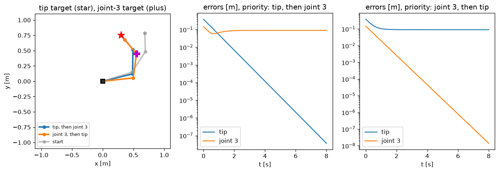
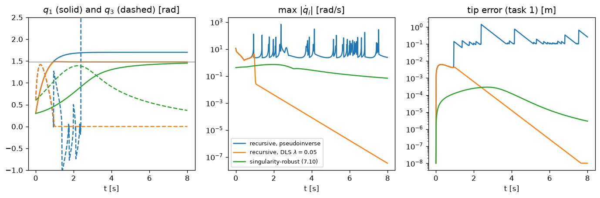

# 7 · Task-priority control

Chapter 6 used the null space for a *soft* wish — a cost to lower when the task allows it. Often there are
several *tasks*, each with its own error and gain, and they cannot all be met: keep the tip on the target, keep the
elbow away from a wall, keep a joint where the cable allows. **Task-priority control** orders them: task 1 is met
as well as the arm can; task 2 is met as well as possible *without disturbing task 1*; task 3 without disturbing
tasks 1 and 2; and so on. This chapter derives the two-task solution, the recursive formulation for $N$ tasks, and
its weak point — **algorithmic singularities**, where the tasks start to conflict. Notation:
[00_notation.md](00_notation.md); null space: [chapter 6](06_redundancy.md); damping: [chapter 5](05_singularities.md).

## 7.1 Tasks

A task is a variable $\sigma_i(q) \in \mathbb{R}^{m_i}$ with Jacobian $J_i = \partial\sigma_i/\partial q$, a desired
value $\sigma_{d,i}$ and a gain $K_i$. The end-effector pose of chapter 4 is one example; so are the position of
any point on the arm, a single joint angle, or a distance (chapter 8). The tasks are listed from highest to lowest
priority,

$$
(\sigma_1, J_1),\ (\sigma_2, J_2),\ \dots,\ (\sigma_N, J_N), \tag{7.1}
$$

and each asks for the closed-loop task velocity of chapter 4,

$$
v_i = \dot\sigma_{d,i} + K_i\,\tilde\sigma_i, \qquad \tilde\sigma_i = \sigma_{d,i} - \sigma_i. \tag{7.2}
$$

In the code a task is an object that recomputes $J_i$ and $\tilde\sigma_i$ from the robot model
(`FrameTask` for selected components of a frame's pose — any DH frame, not only the end effector — and
`JointTask` for one joint), and the solver only sees the list of pairs $(J_i, v_i)$. Chapter 8 adds tasks that
switch on and off; chapter 9 swaps the arm model for a mobile manipulator without touching the tasks.

## 7.2 Two tasks

Start from the general solution (6.1) of task 1 and choose $z$ for task 2 [1]:

$$
\dot q = J_1^\dagger v_1 + N_1 z, \qquad
J_2\dot q = v_2 \ \Rightarrow\ (J_2N_1)\,z = v_2 - J_2J_1^\dagger v_1
\ \Rightarrow\ z = (J_2N_1)^\dagger\big(v_2 - J_2J_1^\dagger v_1\big). \tag{7.3}
$$

Read it in words: $J_2J_1^\dagger v_1$ is what task 1's motion already does to task 2; the remainder is corrected
with the part of the joint space that task 1 does not use. The matrix

$$
\bar J_2 = J_2N_1 \tag{7.4}
$$

is the **augmented** (or projected) Jacobian of task 2: how task 2 sees the joint velocities that are invisible to
task 1. Because $N_1$ is a symmetric projector, $N_1\bar J_2^\dagger = \bar J_2^\dagger$, so the outer $N_1$ in (7.3) can be
dropped: $\dot q = J_1^\dagger v_1 + \bar J_2^\dagger(v_2 - J_2J_1^\dagger v_1)$.

What it achieves: task 1 exactly (if $J_1$ has full row rank); task 2 in the least-squares sense among all
solutions of task 1; and among those, the smallest $\lVert\dot q\rVert$. If the two tasks are **compatible** — the
stacked Jacobian $[J_1; J_2]$ has full row rank, so in particular $m_1 + m_2 \le n$ — both are met exactly and the
result equals the minimum-norm solution of the stacked system, whatever the order. If they **conflict**, the order
decides who wins. The tests check both statements: the compatible case against $[J_1;J_2;J_3]^\dagger$, the
conflicting case against a constrained least-squares problem solved through an orthonormal basis of
$\mathcal{N}(J_1)$ computed by LU and QR.

**Example.** The three-link arm of chapter 6 is given two position tasks, its tip to $(0.30, 0.75)$ m and the
origin of joint 3 (DH frame 2) to $(0.55, 0.45)$ m: four equations for three joints. With the tip first, the tip
error converges to zero and the joint-3 point stops 9.05 cm short; with the order swapped it is the other way round
(Figure 7.1). The two residuals happen to be equal here: the targets are $0.39$ m apart and the last link is
$0.30$ m long, so whichever point is placed, the other is at best $0.39 - 0.30 = 0.09$ m from its target.

*Figure 7.1 — Two conflicting position tasks on a three-link arm ($K_i = 2I$, $\Delta t = 10$ ms). The task with
priority converges exponentially; the other settles at the best value the null space of the first allows.
Generated by `tools/make_figures.py`.*

## 7.3 N tasks: the recursive formulation

Apply (7.3) repeatedly. Let $P_{i-1}$ be the projector onto the null space shared by tasks $1, \dots, i-1$, and
$\dot q_{i-1}$ the velocity that serves them. Then, with $\dot q_0 = 0$ and $P_0 = I$ [2, 3],

$$
\dot q_i = \dot q_{i-1} + \bar J_i^{\#}\big(v_i - J_i\,\dot q_{i-1}\big), \qquad \bar J_i = J_iP_{i-1}, \tag{7.5}
$$

$$
P_i = P_{i-1} - \bar J_i^\dagger\bar J_i, \tag{7.6}
$$

and the command is $\dot q = \dot q_N$. Equation (7.6) works because $\bar J_i^\dagger\bar J_i$ is the projector onto the
row space of $\bar J_i$, which lies inside the range of $P_{i-1}$; removing it leaves the joint velocities that
neither tasks $1..i-1$ nor task $i$ can see:

$$
P_i = \text{projector onto } \mathcal{N}(J_1)\cap\dots\cap\mathcal{N}(J_i) = I - [J_1;\dots;J_i]^\dagger[J_1;\dots;J_i]. \tag{7.7}
$$

The test `hierarchy projector spans the common null space` checks (7.7). Each level only *adds* a term inside the
range of $P_{i-1}$, so it cannot disturb any higher task. The inverse $\bar J_i^{\#}$ in (7.5) may be the
pseudoinverse or the DLS inverse; the projector (7.6) is always computed with the exact pseudoinverse, so that a
damped level does not leak into the levels above it (the leak of section 6.5).

## 7.4 Algorithmic singularities

Even when every $J_i$ has full rank, the augmented Jacobian $\bar J_i = J_iP_{i-1}$ can lose rank. This happens
when task $i$ asks for a motion that only the higher tasks' directions could produce — when the tasks start to
conflict:

$$
\operatorname{rank}\bar J_i < \operatorname{rank}J_i \iff \operatorname{rank}\,[J_1;\dots;J_i] <
\operatorname{rank}\,[J_1;\dots;J_{i-1}] + \operatorname{rank}J_i. \tag{7.8}
$$

Such a configuration is an **algorithmic singularity** [4]: the arm is not singular, the *combination* of tasks
is. Near it $\bar J_i^\dagger$ has a huge gain, exactly like $J^\dagger$ near a kinematic singularity (chapter 5).

**Worked example.** Task 1: the tip $(x, y)$ of the three-link arm. Task 2: joint 1 to a desired angle,
$J_2 = [1\ 0\ 0]$. The null space of $J_1$ is spanned by $n = a \times b$, the cross product of the two rows of
$J_1$ (chapter 6, exercise 2), and its first component is the determinant of columns 2 and 3 of $J_1$,
$l_2l_3\sin q_3$. Hence

$$
\lVert\bar J_2\rVert = \lVert J_2N_1\rVert = \frac{\lvert n_1\rvert}{\lVert n\rVert} = \frac{l_2l_3\,\lvert\sin q_3\rvert}{\lVert n\rVert}. \tag{7.9}
$$

At $q_3 = 0$ links 2 and 3 are aligned: with the tip held, joint 1 is at a turning point of its self-motion and
cannot be changed to first order. The test checks (7.9) at several $q_3$, with $J_1$ far from singular.

Hold the tip at its start ($q_0 = (0.3, 0.7, 0.6)$) and ask for $q_1 = 1.7$ rad. Along this self-motion manifold
$q_1$ is at most $1.479$ rad, reached at $q_3 = 0$, so the goal pulls the arm into the algorithmic singularity
(Figure 7.2, $K_i = 2$, $\Delta t = 10$ ms):

- **Pseudoinverse:** joint rates up to 680 rad/s; $q_3$ changes sign 16 times, and the integrated steps are so large
  that even the top-priority task is lost (tip error up to 1.4 m).
- **DLS** ($\lambda = 0.05$) in (7.5): rates at most 10.6 rad/s, the tip stays within 6.2 mm, and $q_1$ ends at $1.478$ rad — as far as it can go. The
  tip error is an effect of the Euler step while the joints are fast: 6.2, 3.0 and 0.6 mm for $\Delta t = 10$, 5
  and 1 ms.

*Figure 7.2 — The three-link arm holds its tip while joint 1 is driven towards an unreachable 1.7 rad (grey line:
the reachable maximum 1.479 rad). Generated by `tools/make_figures.py`.*

## 7.5 The singularity-robust alternative

Chiaverini [5] avoids the augmented Jacobian altogether: invert each task on its own, then project,

$$
\dot q = J_1^{\#}v_1 + N_1J_2^{\#}v_2, \qquad\text{in general}\qquad \dot q = \sum_{i=1}^{N}P_{i-1}J_i^{\#}v_i. \tag{7.10}
$$

$J_i^{\#}$ only meets the *kinematic* singularities of task $i$, never an algorithmic one, and $P_{i-1}$ is a
projector, so the lower terms cannot blow up. The price is that the lower tasks are no longer met exactly even when
they are compatible, because the term $-J_i\dot q_{i-1}$ of (7.5) — the correction for what the higher tasks already
did — is missing; the test checks that task 2 is missed by a random compatible pair under (7.10) but met under
(7.5). In the worked example (7.10) moves slowly (at most 0.72 rad/s), keeps the tip within 0.3 mm, and has brought
$q_1$ only to $1.451$ rad after 8 s. Stability of these closed loops is analysed by Antonelli [6].

Which to use? The recursive form with DLS is the standard in practice: exact when the tasks are compatible,
bounded near algorithmic singularities. Damping costs accuracy only where the tasks conflict anyway.

## 7.6 Algorithm

**Task-priority step** (`task_priority_step`, simulated by `simulate_task_priority`):

1. For every task in priority order, update $J_i$ and $\tilde\sigma_i$ at $q_k$ and form $v_i$ (7.2). Skip tasks
   that are not active (chapter 8).
2. Set $\dot q = 0$, $P = I$.
3. For each active task: $\bar J = J_iP$; $\dot q \mathrel{+}= \bar J^{\#}(v_i - J_i\dot q)$ (7.5), or
   $\dot q \mathrel{+}= PJ_i^{\#}v_i$ for (7.10); then $P \mathrel{-}= \bar J^\dagger\bar J$ (7.6).
4. Scale $\dot q$ down uniformly if an entry exceeds its speed limit; integrate.

## 7.7 Common mistakes

- **Forgetting the correction $-J_i\dot q_{i-1}$.** Without it the recursion becomes (7.10), with its loss of
  accuracy, by accident rather than by choice.
- **Projecting with the null space of task $i-1$ only.** $P_{i-1}$ must remove the directions of *all* higher
  tasks (7.7); $N_{i-1}$ alone lets task $i$ disturb task $i-2$.
- **Damping the projector.** Using the DLS inverse in (7.6) makes $P$ leak, and lower tasks disturb higher ones.
- **Putting safety last.** Joint limits and collision avoidance go at the top; the end-effector task comes after.
  An order is a design decision, not a detail.
- **Expecting all tasks to converge.** With conflicting tasks the lower ones settle at a residual; that is the
  intended behaviour, not a bug in the gains.
- **Mixing units inside one level.** Priority between levels is unit-free, but within a level (a pose task)
  metres and radians are traded against each other as in chapter 5.

## References

1. Y. Nakamura, H. Hanafusa, T. Yoshikawa, "Task-priority based redundancy control of robot manipulators", *Int.
   J. Robotics Research* 6(2):3–15, 1987.
2. B. Siciliano, J.-J. E. Slotine, "A general framework for managing multiple tasks in highly redundant robotic
   systems", *Proc. Int. Conf. Advanced Robotics (ICAR)*, 1211–1216, 1991.
3. P. Baerlocher, R. Boulic, "An inverse kinematics architecture enforcing an arbitrary number of strict priority
   levels", *The Visual Computer* 20(6):402–417, 2004.
4. A. A. Maciejewski, C. A. Klein, "Obstacle avoidance for kinematically redundant manipulators in dynamically
   varying environments", *Int. J. Robotics Research* 4(3):109–117, 1985.
5. S. Chiaverini, "Singularity-robust task-priority redundancy resolution for real-time kinematic control of
   robot manipulators", *IEEE Trans. Robotics and Automation* 13(3):398–410, 1997.
6. G. Antonelli, "Stability analysis for prioritized closed-loop inverse kinematic algorithms for redundant
   robotic systems", *IEEE Trans. Robotics* 25(5):985–994, 2009.
