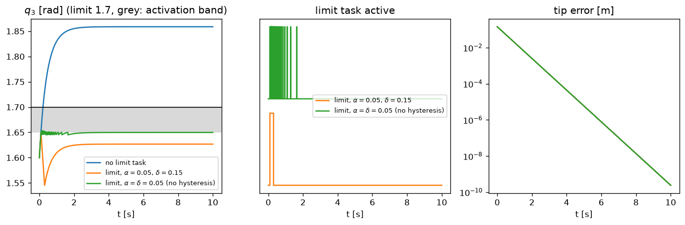
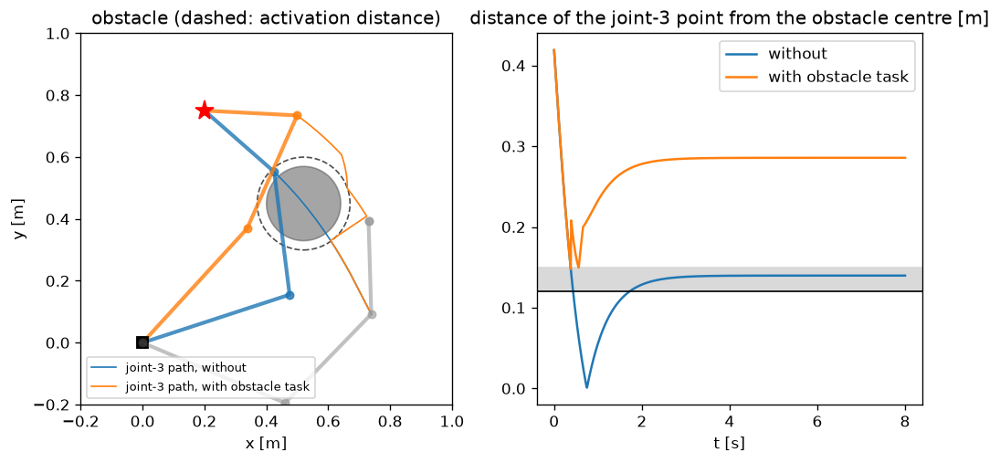

# 8 · Inequality tasks

Most safety requirements are not "be here" but "do not go there": a joint must stay inside its range, a link
must keep a distance from an obstacle, a mobile base must not leave the room. These are **inequality tasks**,
$\sigma_{\min} \le \sigma(q) \le \sigma_{\max}$. Far from the bounds they ask for nothing and should cost no
redundancy; near a bound they must take the highest priority. This chapter turns an inequality into a task that
enters and leaves the hierarchy of chapter 7 — a **set-based** task with activation thresholds — and shows the
classic problem of this approach, **chattering**, and its cure, hysteresis. Notation:
[00_notation.md](00_notation.md); hierarchy: [chapter 7](07_task_priority.md).

## 8.1 From an inequality to a task

An inequality task is a scalar $\sigma(q)$ with Jacobian $J_\sigma$ and a valid set

$$
\sigma_{\min} \le \sigma(q) \le \sigma_{\max}. \tag{8.1}
$$

Joint centering (chapter 6) only *prefers* the middle of the range; the worked example there took joint 3 to
2.36 rad past a 2 rad limit. Putting the inequality permanently at the top of the hierarchy as an equality
$\sigma = \sigma_d$ would waste a degree of freedom on a value that does not matter. The set-based approach
[1, 2, 3] does neither: the hierarchy of chapter 7 is applied to the **active** tasks only,

$$
\mathcal{A}(t) = \{\text{equality tasks}\} \cup \{\text{inequality tasks near a bound}\}, \tag{8.2}
$$

so an inequality task uses redundancy only while it is needed. Because it sits above the end-effector task, the
lower tasks act in its null space while it is active: they can no longer push $\sigma$ further towards the bound.

## 8.2 Activation and hysteresis

An inequality task switches on when $\sigma$ comes within $\alpha$ of a bound and off when it is $\delta$ away from
it again. With an activation state $a \in \{-1, 0, +1\}$ (the sign is the direction in which the task pushes
$\sigma$):

$$
a \leftarrow \begin{cases}
-1 & a = 0,\ \sigma \ge \sigma_{\max} - \alpha \\
+1 & a = 0,\ \sigma \le \sigma_{\min} + \alpha \\
\ \ 0 & a = -1,\ \sigma \le \sigma_{\max} - \delta \ \text{ or } \ a = +1,\ \sigma \ge \sigma_{\min} + \delta \\
\ \ a & \text{otherwise.}
\end{cases} \tag{8.3}
$$

While active, the task asks for a push away from the bound at a constant rate,

$$
v = K\,a, \qquad K > 0, \tag{8.4}
$$

and keeps it up until $\sigma$ has crossed the release threshold. This releases reliably: a pull towards the release threshold with an
exponential law $K(\sigma_{\max} - \delta - \sigma)$ would approach that threshold without ever crossing it and keep the
task — and the joint — frozen.

With $\delta > \alpha$ there is a **hysteresis band** of width $\delta - \alpha$ between switching on and switching off.
With $\delta = \alpha$ there is none: when the lower tasks keep pushing towards the bound, the task switches off as
soon as it has pushed $\sigma$ out of the activation band, the lower tasks push it back in during the next step, and
the task switches on again. This is **chattering**: the command jumps at every switch.

Why $\alpha > 0$ at all? The task acts only from the step *after* $\sigma$ entered the band, so in discrete time
$\sigma$ moves on by up to $\Delta t\,\lvert\dot\sigma\rvert$ before it is stopped. The margin $\alpha$ must cover this.

## 8.3 Two inequality tasks

**Joint limit.** $\sigma = q_j$, valid set $[q_{j,\min}, q_{j,\max}]$, Jacobian the unit row

$$
J_\sigma = e_j^T. \tag{8.5}
$$

**Distance from an obstacle.** For a point $p(q)$ on the arm (the origin of a frame) and an obstacle with centre
$c$ and radius $r$ (or a point obstacle enlarged by a safety distance), $\sigma = \lVert p - c\rVert \ge r$, with
$\sigma_{\max} = \infty$ and

$$
J_\sigma = \frac{(p - c)^T}{\lVert p - c\rVert}\,J_P, \tag{8.6}
$$

the position Jacobian of the point projected on the direction away from the obstacle [4]. The test compares (8.6)
with finite differences on the PUMA. For an arm moving in a plane, only the $(x, y)$ components are used. A full
treatment computes the closest pair of points between each link and each obstacle; one point per link is the
simplest version and already shows the method.

## 8.4 Joint limit: worked example

The three-link arm of chapter 6 moves its tip from $q_0 = (1.2, -1.5, 1.6)$ rad to $(0.6, 0.5)$ m. Without a limit
task joint 3 goes to $1.859$ rad. Limit it to $\pm 1.7$ rad with $\alpha = 0.05$, $\delta = 0.15$ rad and
$K = 0.5$ rad/s, above the tip task ($K = 2$, $\Delta t = 10$ ms; Figure 8.1):

- joint 3 peaks at $1.650$ rad, just inside the activation band; the task switches on once and off once;
- the tip still converges, with exactly the same error history as without the limit (final error
  $2.4\times10^{-10}$ m after 10 s): the tasks are compatible, $1 + 2 \le 3$, so the limit costs no accuracy, only
  redundancy;
- with less hysteresis the switching multiplies: 8 switches for $\delta = 0.08$ and 48 — in the first 1.7 s — for
  $\delta = \alpha$;
- with $\alpha = \delta = 0$ joint 3 overshoots the limit by 3 mrad (1.703 rad), the one-step delay of section 8.2.

*Figure 8.1 — Joint 3 limited to 1.7 rad. Left: joint 3; centre: when the limit task is active; right: tip error
(identical for all three runs). Generated by `tools/make_figures.py`.*

## 8.5 Obstacle: worked example

The arm moves its tip from $q_0 = (-0.4, 1.2, 0.8)$ rad to $(0.2, 0.75)$ m. Without precautions the origin of joint 3
passes within 1 mm of the centre of an obstacle of radius $0.12$ m placed on its path. An obstacle task on that
point ($\alpha = 0.03$, $\delta = 0.08$ m, $K = 0.5$ m/s), above the tip task, keeps it at $0.148$ m or more; the
task is active for $0.11$ s in two short episodes (4 switches), the arm takes the other way round the obstacle,
and the tip reaches the target (error $7\times10^{-8}$ m after 8 s; Figure 8.2).

*Figure 8.2 — The joint-3 point avoids an obstacle while the tip reaches its target. Left: paths of the joint-3
point and final configurations; right: distance from the obstacle centre (black: radius, grey: activation
band). Generated by `tools/make_figures.py`.*

## 8.6 Limits of the method

- **Discontinuous commands.** When a task enters or leaves the active set, $\dot q$ jumps. Hysteresis makes the
  jumps rare; it does not remove them. Continuous alternatives blend a task in with an activation weight
  [5], or solve each level as a quadratic program with the inequalities as constraints [6, 7] — the hierarchical QP
  used by most humanoid controllers today.
- **A lower task that keeps pushing into the bound.** Then the inequality task cycles: on, push out, off, pushed
  back, on again. Hysteresis sets the period; it cannot remove the cycle. With an obstacle (radius 0.1 m) placed
  over the tip's own target, an obstacle task on the tip keeps it at 0.119 m or more but switches 58 times in 8 s
  ($\delta = 0.05$ m). Put below the tip task instead, the obstacle task loses: the tip goes in to 0.048 m. (Below a
  conflicting task an inequality task also meets an algorithmic singularity, chapter 7: those runs use DLS.)
- **Conflicts among the safety tasks.** Two active inequality tasks (two limits, or a limit and an obstacle) can
  conflict with each other; then the order between them decides which bound is respected.
- **Local minima.** An obstacle task blocks; it does not plan. If the target is behind the obstacle and the
  null space offers no way round, the arm stops at the obstacle.
- **One point per link.** A point task protects a point. Links between the points need more points or a
  closest-distance computation.

## 8.7 Algorithm

**Task-priority step with inequality tasks** (the same `task_priority_step` as chapter 7):

1. Update every task at $q_k$. An inequality task computes $\sigma$ and $J_\sigma$, updates its activation by (8.3)
   and sets its error to $a$ (8.4).
2. Keep the active tasks (8.2) in their priority order — inequality tasks first.
3. Solve the hierarchy with (7.5)–(7.6) and integrate.

## 8.8 Common mistakes

- **No hysteresis** ($\delta = \alpha$): chattering whenever a lower task pushes towards the bound.
- **No margin** ($\alpha = 0$): the bound is crossed by one step's motion before the task reacts.
- **Inequality tasks below the end-effector task.** They then act only in the null space of the end-effector
  task and cannot stop it.
- **A proportional pull to the release threshold.** It never crosses it; the task never releases and the joint
  stays frozen.
- **Activation state kept between unrelated runs.** The task remembers whether it was active; reset it when the
  robot is restarted.

## References

1. G. Antonelli, F. Arrichiello, S. Chiaverini, "The null-space-based behavioral control for autonomous robotic
   systems", *Intelligent Service Robotics* 1(1):27–39, 2008.
2. S. Moe, G. Antonelli, A. R. Teel, K. Y. Pettersen, J. Schrimpf, "Set-based tasks within the singularity-robust
   multiple task-priority inverse kinematics framework: general formulation, stability analysis, and
   experimental results", *Frontiers in Robotics and AI* 3:16, 2016.
3. E. Simetti, G. Casalino, "A novel practical technique to integrate inequality control objectives and task
   transitions in priority based control", *J. Intelligent & Robotic Systems* 84:877–902, 2016.
4. A. A. Maciejewski, C. A. Klein, "Obstacle avoidance for kinematically redundant manipulators in dynamically
   varying environments", *Int. J. Robotics Research* 4(3):109–117, 1985.
5. N. Mansard, O. Khatib, A. Kheddar, "A unified approach to integrate unilateral constraints in the stack of
   tasks", *IEEE Trans. Robotics* 25(3):670–685, 2009.
6. O. Kanoun, F. Lamiraux, P.-B. Wieber, "Kinematic control of redundant manipulators: generalizing the
   task-priority framework to inequality task", *IEEE Trans. Robotics* 27(4):785–792, 2011.
7. A. Escande, N. Mansard, P.-B. Wieber, "Hierarchical quadratic programming: fast online humanoid-robot motion
   generation", *Int. J. Robotics Research* 33(7):1006–1028, 2014.

*Acknowledgement: chapters 8–9 grew out of joint work with Gebrecherkos Gebreslassie on a mobile manipulator
controlled by task priority.*
