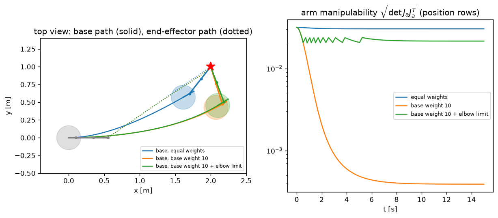
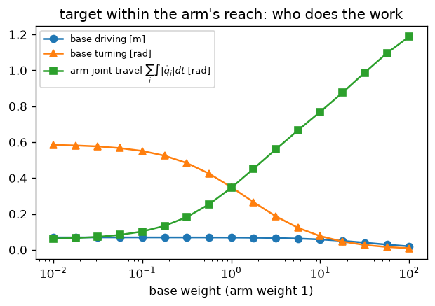

# 9 · Mobile manipulators

An arm on a wheeled base can reach anywhere the base can drive. Kinematically, the base adds degrees of freedom,
so even a small arm becomes redundant — and everything in chapters 6–8 applies, provided base and arm are written
as **one kinematic system**. The catch is that a wheeled base is **nonholonomic**: it cannot move sideways, so its
velocities are not the derivatives of its coordinates. This chapter writes the kinematics of a differential-drive
base carrying an arm, its Jacobian in terms of the commanded speeds, the exact integration of the base motion, and
the weighting that decides whether the base or the arm does the work. Notation: [00_notation.md](00_notation.md);
hierarchy: [chapter 7](07_task_priority.md); inequality tasks: [chapter 8](08_inequality_tasks.md).

## 9.1 The base: a unicycle

A differential-drive base is commanded by its forward speed $v$ and its turn rate $\omega$ (the two wheel speeds
are a fixed linear function of them). Its pose in the plane, $\eta = (x, y, \psi)$, evolves as the **unicycle**

$$
\dot x = v\cos\psi, \qquad \dot y = v\sin\psi, \qquad \dot\psi = \omega. \tag{9.1}
$$

Three coordinates, two inputs: the base cannot slide sideways,

$$
\dot x\sin\psi - \dot y\cos\psi = 0. \tag{9.2}
$$

This constraint on velocities cannot be integrated into a constraint on positions — the base can still reach every
pose, by manoeuvring — so it is **nonholonomic** [1, 2]. For control it means: write the Jacobian in terms of the
inputs $(\omega, v)$, not of $\dot\eta$.

## 9.2 Base and arm as one system

The arm (joint vector $q_a \in \mathbb{R}^n$, forward kinematics $T_a(q_a)$ of chapter 2) is bolted to the base
by a constant mounting transform $T_m$ [4, 5, 7]. The end-effector pose in the world is

$$
T_e(q) = T_b(\eta)\,T_m\,T_a(q_a), \qquad
T_b(\eta) = \begin{bmatrix} R_z(\psi) & (x, y, 0)^T \\ 0 & 1\end{bmatrix}. \tag{9.3}
$$

The configuration and the commanded velocities (quasi-velocities) are

$$
q = (x, y, \psi, q_a) \in \mathbb{R}^{3+n}, \qquad \zeta = (\omega, v, \dot q_a) \in \mathbb{R}^{2+n},
\qquad \dot q = S(q)\,\zeta, \quad
S = \begin{bmatrix} 0 & \cos\psi & 0 \\ 0 & \sin\psi & 0 \\ 1 & 0 & 0 \\ 0 & 0 & I_n\end{bmatrix}. \tag{9.4}
$$

The Jacobian that the task-priority controller needs maps $\zeta$ — what we can command — to the twist of a frame
on the robot. By the chain rule it is $J = (\partial T/\partial q)\,S$; column by column, for a frame with origin $p$
and the base origin $p_b = (x, y, 0)$:

$$
J = \Big[\ \underbrace{\begin{pmatrix} \hat z \times (p - p_b) \\ \hat z\end{pmatrix}}_{\omega}\ \
\underbrace{\begin{pmatrix} (\cos\psi, \sin\psi, 0)^T \\ 0\end{pmatrix}}_{v}\ \
\underbrace{\begin{pmatrix} R & 0 \\ 0 & R\end{pmatrix} J_a(q_a)}_{\dot q_a}\ \Big], \tag{9.5}
$$

with $R$ the rotation of $T_b T_m$ and $J_a$ the arm's own geometric Jacobian in its base frame (chapter 3).
Turning the base rotates the whole robot about the vertical axis through $p_b$; driving translates it along the
heading; the arm columns are the arm's Jacobian seen from the world. For the base frame itself the arm columns are
zero and no command moves the base sideways — (9.2) is built in. The tests check (9.5) for the end effector, the
base and every arm frame against finite differences of the integrated motion.

The tasks of chapters 7–8 do not change: a `FrameTask` on frame $-1$ (end effector) or frame $0$ (the base) and a
`JointLimitTask` on an arm joint work unchanged with the `MobileManipulator` model, which supplies (9.3)–(9.6).
The whole robot with $n = 3$ arm joints has five inputs for a three-dimensional position task: two degrees of
redundancy, even though the arm alone has none.

## 9.3 Integrating the base motion

With $\omega$ and $v$ held constant over a control period $\Delta t$ (zero-order hold), (9.1) can be integrated
exactly: the base moves on an arc of radius $v/\omega$,

$$
\begin{aligned}
x_{k+1} &= x_k + \frac{v}{\omega}\big(\sin(\psi_k + \omega\Delta t) - \sin\psi_k\big), \\
y_{k+1} &= y_k - \frac{v}{\omega}\big(\cos(\psi_k + \omega\Delta t) - \cos\psi_k\big), \qquad
\psi_{k+1} = \psi_k + \omega\Delta t,
\end{aligned} \tag{9.6}
$$

and on a straight segment when $\omega = 0$. Euler integration of (9.1) instead moves along the initial heading
for the whole period and cuts the corner of every arc; the error per step is $O(\Delta t^2)$. The test checks that (9.6) stays on the circle it should trace and
that $2\times10^5$ Euler steps converge to it.

## 9.4 Who does the work: weighting base and arm

The pseudoinverse minimises $\lVert\zeta\rVert^2$, which adds rad/s of turning, m/s of driving and rad/s of joint
rates as if they were alike. They are not: driving a base is slow, imprecise (wheel slip, odometry drift) and needs
free floor, while the arm is fast and precise. The weighted norm of chapter 6,

$$
\zeta^TW\zeta, \qquad W = \operatorname{diag}(w_\omega, w_v, w_1, \dots, w_n), \tag{9.7}
$$

sets the price of each input; the choice can also be driven by the manipulability of the whole system [6]. For a
whole hierarchy, substitute $\zeta = D\,y$ with $D = W^{-1/2}$, solve the
*unweighted* recursion (7.5)–(7.6) for $y$ with Jacobians $J_iD$, and map back:

$$
\zeta = D\,y, \qquad y = \text{recursion (7.5)–(7.6) with } J_i \to J_iD. \tag{9.8}
$$

Minimising $\lVert y\rVert^2$ is minimising $\zeta^TW\zeta$, and $J_iD\,y = J_i\zeta$, so every task sees the same
motion. For one level this is exactly the weighted pseudoinverse (6.6), which the test checks. Weights also fix the
units: $w_v$ is per (m/s)², the others per (rad/s)².

## 9.5 Worked example

The robot: an anthropomorphic arm (waist, shoulder, elbow; $d_1 = 0.1$, $a_2 = 0.3$, $a_3 = 0.25$ m) mounted
0.1 m ahead of the base origin and 0.2 m up; the arm alone reaches 0.55 m from its shoulder. Starting at the
origin with $q_a = (0, 0.6, -1.2)$ rad, the end effector must reach $(2.0, 1.0, 0.3)$ m, 2.2 m away (position task,
$K = 1$, DLS with $\lambda = 0.05$, $\Delta t = 10$ ms, 15 s; Figure 9.1).

- **Equal weights.** The base drives 1.73 m, the arm joints move 0.75 rad in total, the end effector converges
  (error $5\times10^{-7}$ m) and the arm keeps its posture (manipulability of the arm's position Jacobian
  $0.032 \to 0.030$).
- **Base weight 10.** Now the arm is cheap, so it reaches out first — until it is fully stretched: the elbow ends
  at $-0.009$ rad and the arm's manipulability drops to $0.0004$, a boundary singularity (chapter 5). The base
  still has to drive 2.14 m, because the target is out of the arm's reach whatever the weights; DLS keeps the
  rates bounded but slows convergence (error $1.4\times10^{-5}$ m).
- **Base weight 10 and an elbow limit** $q_3 \le -0.5$ rad (chapter 8, above the end-effector task): the elbow
  stays below $-0.541$ rad and the manipulability above $0.020$; the error is $5\times10^{-6}$ m. The arm keeps
  pushing the elbow into the limit, so the limit task cycles — 18 switches, the sawtooth in Figure 9.1 — as in
  section 8.6.

*Figure 9.1 — Top view of the base and end-effector paths and final configurations (left), and the arm's
manipulability (right), for three weightings. Generated by `tools/make_figures.py`.*

The weight decides who works only where there is a choice. For a target the arm could reach alone,
$(0.4, 0.3, 0.35)$ m, raising the base weight from 0.01 to 100 lowers the base's driving from 0.069 to 0.020 m and
its turning from 0.585 to 0.009 rad, while the arm's joint travel rises from 0.06 to 1.19 rad (Figure 9.2).

*Figure 9.2 — Base driving, base turning and arm joint travel against the base weight, for a target within the
arm's reach (elbow limit active). Generated by `tools/make_figures.py`.*

## 9.6 Base tasks and what the base cannot do

A task on frame 0 controls the base directly: its heading (component 5) or its position (components 0, 1). A base
*position* task has a $2\times(2+n)$ Jacobian of rank 1 — only the forward direction is available — so at any
instant it can correct only the error along the heading, and it reaches a point beside the base only by turning
first. Point stabilisation of a nonholonomic base to a full pose $(x, y, \psi)$ is impossible with a smooth
time-invariant feedback (Brockett's condition [3]); in a mobile manipulator this rarely matters, because the arm
supplies the missing directions at the end effector.

## 9.7 Algorithm

**Task-priority step for a mobile manipulator** (`task_priority_step` with a `MobileManipulator` model and
`PriorityConfig::weights`):

1. Update every task with the model: frame poses by (9.3), Jacobians by (9.5) (columns $\omega$, $v$, arm joints).
2. Solve the hierarchy of active tasks with the weighted recursion (9.8) (DLS recommended near the arm's
   workspace boundary).
3. Send $(\omega, v)$ to the base and $\dot q_a$ to the arm; in simulation integrate the base with (9.6) and the
   arm with Euler.

## 9.8 Common mistakes

- **Treating the base as three free joints** $(\dot x, \dot y, \dot\psi)$. The controller then asks for sideways
  motion the wheels cannot produce; the base drifts from the plan. Use the inputs $(\omega, v)$ and (9.5).
- **Forgetting that turning the base moves the arm.** The $\omega$ column has the lever arm $\hat z \times (p - p_b)$;
  dropping it is the most common error in a hand-written Jacobian.
- **Arm Jacobian in the wrong frame.** $J_a$ is expressed in the arm's base frame; rotate it by $R$ of $T_bT_m$.
- **Unweighted mix of units.** Without $W$ the solution depends on whether $v$ is in m/s or mm/s.
- **A heavy base without arm limits.** The arm stretches into its boundary singularity; add joint limits (or a
  manipulability task) above the end-effector task.

## References

1. B. Siciliano, L. Sciavicco, L. Villani, G. Oriolo, *Robotics: Modelling, Planning and Control*, Springer,
   2009, sec. 11.1–11.4.
2. K. M. Lynch, F. C. Park, *Modern Robotics*, Cambridge University Press, 2017, ch. 13.
3. R. W. Brockett, "Asymptotic stability and feedback stabilization", in *Differential Geometric Control
   Theory*, Birkhäuser, 1983, 181–191.
4. Y. Yamamoto, X. Yun, "Coordinating locomotion and manipulation of a mobile manipulator", *IEEE Trans.
   Automatic Control* 39(6):1326–1332, 1994.
5. H. Seraji, "A unified approach to motion control of mobile manipulators", *Int. J. Robotics Research*
   17(2):107–118, 1998.
6. B. Bayle, J.-Y. Fourquet, M. Renaud, "Manipulability of wheeled mobile manipulators: application to motion
   generation", *Int. J. Robotics Research* 22(7–8):565–581, 2003.
7. A. De Luca, G. Oriolo, P. R. Giordano, "Kinematic modeling and redundancy resolution for nonholonomic mobile
   manipulators", *Proc. IEEE ICRA*, 1867–1873, 2006.
