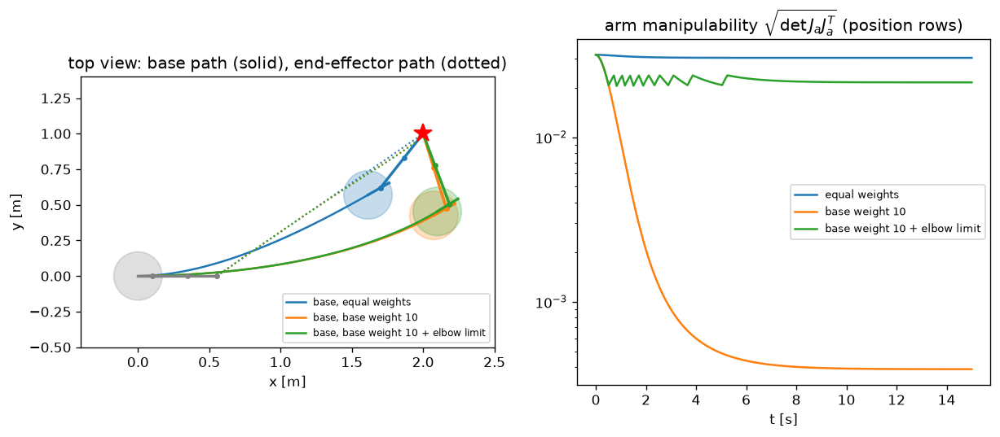

# learn-manipulator-control

Kinematic control of manipulators, from one Jacobian to many prioritized tasks: rigid-body transforms, forward
kinematics, the Jacobian, resolved-rate control, singularities, redundancy, task-priority control, inequality
tasks and mobile manipulators. Each chapter has a theory text, a C++17 library (`manipulator_control`) tested
against independent references (Pinocchio where installed), and Python notebooks that call it.



*Chapter 9: a mobile manipulator reaching a goal with different base weights, and the arm's manipulability.*

## Chapters

| # | Chapter | Theory | Code | Notebook |
|---|---------|--------|------|----------|
| 1 | Rigid-body transforms | [text](1_theory/01_rigid_body_transforms.md) | [transforms.hpp](cpp/include/manipulator_control/transforms.hpp) | [exercises](2_notebooks/exercises/01_rigid_body_transforms.ipynb) · [solutions](2_notebooks/solutions/01_rigid_body_transforms.ipynb) |
| 2 | Forward kinematics | [text](1_theory/02_forward_kinematics.md) | [kinematics.hpp](cpp/include/manipulator_control/kinematics.hpp) · [robot_model.hpp](cpp/include/manipulator_control/robot_model.hpp) | [exercises](2_notebooks/exercises/02_forward_kinematics.ipynb) · [solutions](2_notebooks/solutions/02_forward_kinematics.ipynb) |
| 3 | The Jacobian | [text](1_theory/03_jacobian.md) | [jacobian.hpp](cpp/include/manipulator_control/jacobian.hpp) | [exercises](2_notebooks/exercises/03_jacobian.ipynb) · [solutions](2_notebooks/solutions/03_jacobian.ipynb) |
| 4 | Resolved-rate motion control | [text](1_theory/04_resolved_rate_control.md) | [resolved_rate.hpp](cpp/include/manipulator_control/resolved_rate.hpp) | [exercises](2_notebooks/exercises/04_resolved_rate_control.ipynb) · [solutions](2_notebooks/solutions/04_resolved_rate_control.ipynb) |
| 5 | Singularities | [text](1_theory/05_singularities.md) | [singularities.hpp](cpp/include/manipulator_control/singularities.hpp) | [exercises](2_notebooks/exercises/05_singularities.ipynb) · [solutions](2_notebooks/solutions/05_singularities.ipynb) |
| 6 | Redundancy and null space | [text](1_theory/06_redundancy.md) | [redundancy.hpp](cpp/include/manipulator_control/redundancy.hpp) | [exercises](2_notebooks/exercises/06_redundancy.ipynb) · [solutions](2_notebooks/solutions/06_redundancy.ipynb) |
| 7 | Task-priority control | [text](1_theory/07_task_priority.md) | [task_priority.hpp](cpp/include/manipulator_control/task_priority.hpp) · [tasks.hpp](cpp/include/manipulator_control/tasks.hpp) | [exercises](2_notebooks/exercises/07_task_priority.ipynb) · [solutions](2_notebooks/solutions/07_task_priority.ipynb) |
| 8 | Inequality tasks | [text](1_theory/08_inequality_tasks.md) | [inequality_tasks.hpp](cpp/include/manipulator_control/inequality_tasks.hpp) | [exercises](2_notebooks/exercises/08_inequality_tasks.ipynb) · [solutions](2_notebooks/solutions/08_inequality_tasks.ipynb) |
| 9 | Mobile manipulators | [text](1_theory/09_mobile_manipulators.md) | [mobile_manipulator.hpp](cpp/include/manipulator_control/mobile_manipulator.hpp) | [exercises](2_notebooks/exercises/09_mobile_manipulators.ipynb) · [solutions](2_notebooks/solutions/09_mobile_manipulators.ipynb) |

Notation is fixed once in [1_theory/00_notation.md](1_theory/00_notation.md).

## Quick start

```bash
sudo apt install build-essential cmake libeigen3-dev python3-venv
make test                                   # Catch2 tests and Python tests
python3 -m venv .venv && source .venv/bin/activate
pip install -e ".[test,notebooks]"          # builds the Python module manipulator_control (pybind11)
```

Then open `2_notebooks/exercises/` in Jupyter or VS Code: cells marked ✏️ are exercises with a check below them,
cells marked 🔨 break an assumption on purpose. Each notebook also runs on Colab (its first cell installs the
module). Details are in [HOW_TO_RUN.md](HOW_TO_RUN.md).

## Layout

```
1_theory/      chapter texts and figures
2_notebooks/   exercises/ (to fill in) and solutions/ (executed)
cpp/           include/manipulator_control, src, tests (Catch2)
python/        bindings and helpers of the Python module manipulator_control
tools/         figure generator and notebook tooling
```

## Used in

* [vehicle-manipulator-task-priority](https://github.com/Rudip1/vehicle-manipulator-task-priority) — task-priority control of a mobile manipulator in ROS 2 and Gazebo, built on this library's C++.
* [robotics-learning](https://github.com/Rudip1/robotics-learning) — the umbrella of all learn-* modules.

## Acknowledgements

Chapters 8–9 grew out of joint work with Gebrecherkos Gebreslassie.

## Licence

Code: Apache-2.0 ([LICENSE](LICENSE)). Theory texts and figures in `1_theory/`: CC BY 4.0.
